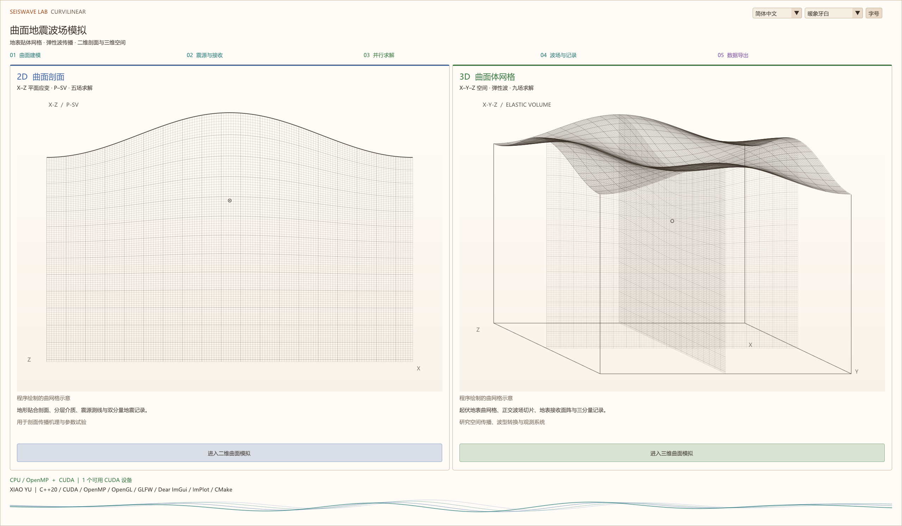
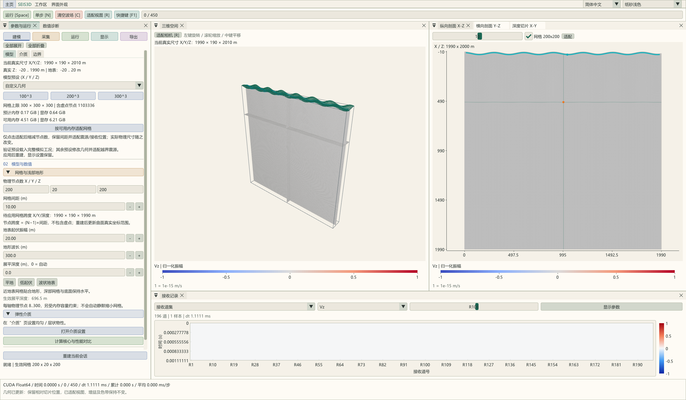

# SeisWave Lab · 二维 / 三维曲面弹性波模拟


二维和三维曲网格各向同性弹性波模拟与交互式可视化工作台。主页左侧进入二维曲面 P–SV 剖面，右侧进入三维曲面体网格。两个维度有独立求解器、模型与记录会话，共用设备检测、差分系数和界面外观。数值核心采用同位网格交替 MacCormack-DRP 空间差分与四阶段时间组合，均支持 CPU/OpenMP 和 CUDA Float64；界面使用 Dear ImGui Docking、ImPlot 和 OpenGL 4.3。

**完整说明**：[二维工作流与五场理论](docs/TWO_D_WORKFLOW.md) · [完整学术说明](docs/PROJECT_MANUAL.md) · [曲网格波场理论整理](docs/CURVILINEAR_WAVE_THEORY.md) · [数值原理](docs/NUMERICAL_METHOD.md) · [操作指南](docs/USER_GUIDE.md) · [构建说明](docs/BUILDING.md) · [文档导航](docs/README.md)



二维提供“建模—采集—运行—显示—导出”流程、真实曲面节点网格、独立模型/波场色标、Vx/Vz 接收测线和 CSV/VTS 导出。默认 200×200、h=2.5 m、f0=30 Hz，每方向支持 8–16384 个物理节点，实际大小受内存/显存限制。二维采用平面应变线源假设，与三维点源的振幅和几何扩散不同；尚不包含 SH 分量。

二维与三维共用地震记录显示模块，支持独立色带、增益、色标范围及 AGC。二维可导入 SEG-Y，并按 Vx/Vz 分量导出 Float32/64 SEG-Y。二维参数编辑与当前模拟参数并排停靠，顶部提供模拟进度条；参数面板支持全部展开/折叠，底部固定“重置并应用”；运行也会先应用待修改参数。F1 帮助横向排列，字体可调；主页示意和底部动态波形均由程序绘制并随主题变化。两维支持可复现模型 VTS 保存/导入及按所选分量导出 Float64 波场，三维 CSV 可多选 Vx/Vy/Vz；详见[模型与波场数据交换](docs/MODEL_AND_WAVEFIELD_IO.md)。详见[记录显示与 SEG-Y](docs/SEGY_AND_RECORDS.md)。二维每方向允许 8–16384 个节点，实际受内存/显存约束；增加分层介质表格与常用预设，以及外部 X–高程剖面导入。主页采用单色密集曲网格，维度切换保留最大化状态。详见[外部高程与模型容量](docs/SURFACE_PROFILES.md)。

任一工作区顶部“主页”按钮可返回维度选择；返回会结束当前会话，重新进入从零时刻开始。`--2d`、`--3d` 可直接进入对应界面。以下列出原三维工作区的功能与范围。震源含义及单位见[震源机制](docs/SOURCE_MECHANISMS.md)；可导入的人工高程输入见[示例高程](resources/examples/elevation/README.md)。主页署名为 XIAO YU，并显示实际技术栈。



## 模拟与显示

- 浅部贴体、深部展平的曲面网格；均匀及分层 Vp、Vs、密度，提供常用介质和几何预设。各物理轴允许 8..300 个节点，实际容量受内存、显存约束。
- 定向体力与各向同性爆炸矩源可切换，均采用 Ricker 子波，位置、方向、幅值和主频可设置；X/Y 接收测线及 X-Y 面阵，最多 1024 个接收位置，保留原始 Vx/Vy/Vz。
- 几何、阻尼及震源采样共同约束 dt；默认目标时长 1 s、最大 5000 步、CFL 系数 0.8，先满足的终止条件生效。
- CPU 串行/OpenMP 与 CUDA 可切换；枚举全部 CUDA 可见设备并逐卡检查，可手动指定计算卡，默认选择总显存最大的可用设备。切换需应用重建，从 t=0 开始，失败保留原会话；一次模拟使用一块 GPU。
- 二维剖面、三维切片与真实尺寸显示；波场和介质各有独立配色、色标，波场色标默认归一化。支持中英文、主题和可停靠工作区。
- 原始/AGC 道集和单道三分量显示；导出 VTS、接收记录 CSV 与计算耗时记录。显示增益、归一化及 AGC 不修改原始数据。

当前边界是局部自由表面闭合与侧面/底面海绵吸收；海绵不等价于 CPML。CPU/CUDA 一致性、有限算例的稳定性与真实物理精度是不同判据。方法、采样要求及证据边界见[学术正文](docs/PROJECT_MANUAL.md)和[验证状态](docs/NUMERICS_AND_VALIDATION.md)。

## 仓库与输出目录

**当前目录就是需要上传的 Git 仓库**，包含构建入口、源码、文档及其图片、图标、工具和许可。无需上传外层工作目录。所有生成文件统一写到本仓库同级的 `../out`：

```text
工作目录/
├─ Seis3D_Curvilinear/       Git 仓库，在 VS 中打开这一层
│  ├─ CMakeLists.txt        独立构建入口
│  ├─ CMakePresets.json     Release / Debug 预设
│  ├─ cmake/               构建布局、选项与目标定义
│  ├─ src/common/          共享设备服务、主页、语言主题
│  ├─ src/two_d/           二维求解、CUDA、验证与 ui/
│  ├─ src/three_d/         三维求解、CUDA、验证与 ui/
│  ├─ include/             SeisCommon、Seis2D、Seis3D 公共头文件
│  ├─ resources/icons/     可随源码提交的图标原件
│  ├─ shaders/ third_party/
│  ├─ docs/                完整文档与 images 图片资源
│  ├─ tools/               验证、分析及博客打包工具
│  └─ LICENSE  THIRD_PARTY_NOTICES.md
└─ out/                    不属于仓库
   ├─ build/x64-Release/    Release 缓存、中间文件
   ├─ build/x64-Debug/      Debug 缓存、中间文件
   ├─ bin/Release/          Release EXE、DLL、着色器与许可
   ├─ bin/Debug/
   ├─ documentation/       生成的离线说明包
   └─ blog/                生成的 GitHub Pages / Hexo 发布包
```

文档图片和应用图标是仓库资源，保留在仓库中；构建缓存、EXE/DLL、模拟导出、原始截图中间文件和发布 ZIP 均留在 `../out`。具体边界见[仓库整理说明](docs/REPOSITORY_LAYOUT.md)。

## 构建与运行

需要 CMake 3.25+、C++20 编译器。Windows 使用 MSVC x64/Ninja；图形界面需要 GLFW、GLEW SDK 和 OpenGL 4.3。默认预设启用 CPU/OpenMP 和 CUDA，完整架构列表需要 CUDA Toolkit 12.8 或支持这些目标的后续版本。命令在本仓库根目录、MSVC 开发者终端执行：

```powershell
cmake --preset x64-Release
cmake --build --preset x64-Release --parallel
ctest --preset x64-Release
..\out\bin\Release\Seis3DCurvilinear.exe
```

在 VS 中直接打开本 Git 仓库，选择 `x64-Release` / `x64-Debug`，将 `Seis3DCurvilinear` 设为启动目标。其他计算机通过 `SEIS3D_GLFW_ROOT`、`SEIS3D_GLEW_ROOT` 指定本机 SDK 路径，详见[构建说明](docs/BUILDING.md)。

无 CUDA Toolkit 时：

```powershell
cmake --preset x64-Release -DSEIS3D_ENABLE_CUDA=OFF
cmake --build --preset x64-Release --parallel
```

仅构建数值核心和命令行时，再加 `-DSEIS3D_BUILD_GUI=OFF`。CUDA 默认包含 RTX 20/30/40/50 的原生目标 `75-real;86-real;89-real;120-real` 和 `75-virtual` PTX，其中 RTX 2060 对应 sm_75；运行端仍需兼容的 NVIDIA 驱动及足够显存。

## 文档、博客与资源

文档正文、18 张三维和完整二维流程的原生 2560×1494 窗口截图、频散分析图及截图参数均在 `docs` 内，GitHub 页面可直接阅读，不依赖本机 `out`。按 `tools/requirements.txt` 安装文档工具依赖后，从仓库根目录运行：

```powershell
python -B tools/package_documentation.py
```

离线图文包生成到 `../out/documentation`，GitHub Pages / Hexo 两版生成到 `../out/blog`。Hexo 图片继续使用 ``，放在文章同名资源目录；发布工具不上传网站。数学公式需由目标主题配置 MathJax/KaTeX。

图标原件为 `resources/icons/seis3d.png`、`seis3d.ico`；Windows 图标编入 EXE，无需单独携带 ICO。着色器在 `shaders`，构建后复制到 EXE 同级。运行程序分发需保留同级 DLL、`shaders`、`licenses`；详细说明见[构建与分发](docs/BUILDING.md)。

实际 DEM 可通过 [Jupyter 剖面提取工具](tools/dem_profiles/README.md)预览并选择矩形范围，沿横向、纵向或任意两点截取实际高程，导出二维模拟需要的 `x_m,elevation_m`。工具独立于模拟程序，保留源高程及原 DEM 坐标，输出统一位于外层 `out/dem_profiles`。

## 操作与来源

Q 切换波场色带，W 切换波场分量，E 切换模型配色，Shift 反向；Space 运行/暂停，N 单步，C 清空波场，R 适配视图，G 网格，B 吸收区域，F1 快捷键帮助。完整说明见[用户指南](docs/USER_GUIDE.md)。

数值方法参考 [CGFD3D](https://github.com/zw-sustech/CGFD3D)。许可见 [LICENSE](LICENSE)，上游软件、第三方库及所保留的参考源码见 [THIRD_PARTY_NOTICES.md](THIRD_PARTY_NOTICES.md)。程序不复现上游完整 MPI/NetCDF/CFS-PML 应用，也不声称任意模型的全波形等价性。
