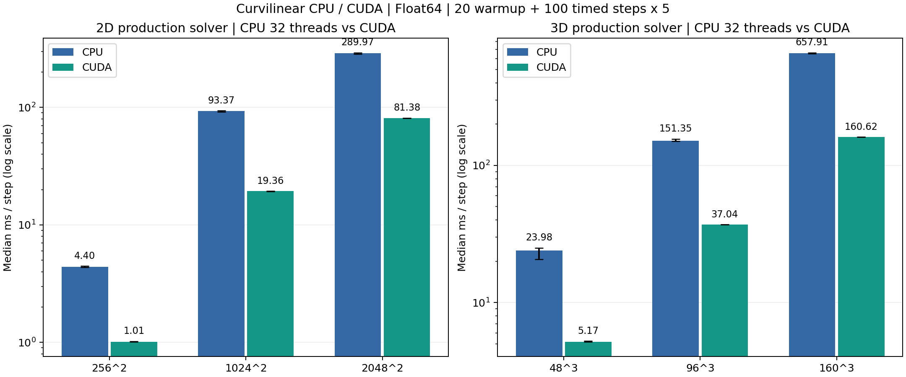
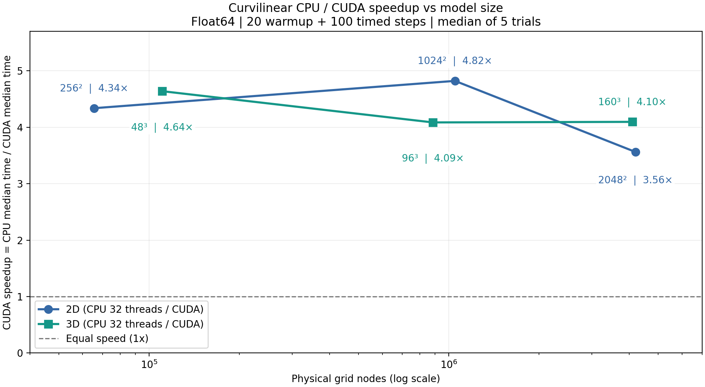

# 曲网格二维 / 三维 CPU 与 CUDA 性能测试

测试日期：2026-10-19。生产求解器、Release、Float64。参照 Cartesian 项目的尺寸、32 线程、20 步预热、100 步计时和 5 次重复中位数方法。

## 测试环境

- CPU：13th Gen Intel(R) Core(TM) i9-13900HX；24 核 / 32 逻辑处理器；OpenMP 32 线程。
- GPU：GPU 0 | NVIDIA GeForce RTX 4060 Laptop GPU。
- 物理内存：15.81 GiB；编译器 MSVC 1944。
- 接电状态：1（1=接电，0=电池，255=未知）；进程高于正常优先级：True。
- 保留非规格化数（FTZ/DAZ 关闭），OMP_WAIT_POLICY=PASSIVE。GPU 每轮先等待 CPU 线程休眠 600 ms，再进行至少 300 ms 的求解预热。
- 本机当次测试结果，未锁定 CPU/GPU 频率。每尺寸先执行 CPU 五轮，再执行 CUDA 五轮；没有随机交错顺序，持续负载与功耗/温度状态可能影响结果。5 次重复的四分位范围用于展示波动，不是置信区间。

## 计时口径与模型

- 只计 `advance(1)` 的墙钟时间；先预热 20 步，再逐步计时 100 步，每后端重复 5 次。重置、初始化、快照下载、比对、导出和渲染不计入推进耗时；初始化时间另列。
- 包含真实生产路径中的 RK4、曲面度量、自由表面、吸收海绵、回滚缓冲、每步数值诊断与一个接收点的采样。CUDA 完成同步包含在生产诊断/采样中，未使用仅记录 kernel 提交时间的计法。
- 曲面起伏 20 m，波长 300 m；网格间距 10 m；震源主频 30 Hz、深度为网格的 1/4；两层介质：Vp/Vs/ρ = 3000/1700/2200 与 4200/2400/2500（SI），层界位于计算深度的中部。二维为五场 P-SV，三维为九场弹性波。
- 时间步由现有几何/CFL/源采样约束自动计算，同一模型 CPU/CUDA 的 dt 必须相等。每轮均从零场重置；快照与接收波形在第 120 步进行比对。
- 30 Hz 与 10 m 是参照模型参数，最慢层在 2.5f₀ 下只有约 2.27 PPW，属于性能压力工况，不作为传播精度验证。
- 三维海绵层请求 16 格/轴，二维使用生产默认 16 格；求解器按模型尺寸限制实际厚度。物理节点数不包含幽灵层；内存存储节点数另列于原始 CSV。

## 性能结果

每步耗时均为 5 次重复的中位数；括号为 P25–P75。加速比 = CPU 中位耗时 / CUDA 中位耗时。吞吐量按物理节点计算，不乘 RK4 阶段数或物理场数。

| 维度 / 档位 | 模型 | CPU ms/步（P25–P75） | CUDA ms/步（P25–P75） | CUDA 加速比 | CPU / CUDA 百万节点·步/秒 |
|---|---|---:|---:|---:|---:|
| 2D 小 | 256×256 | 4.397（4.361–4.471） | 1.013（1.009–1.021） | 4.34× | 14.90 / 64.67 |
| 2D 中 | 1024×1024 | 93.368（92.086–93.955） | 19.361（19.275–19.407） | 4.82× | 11.23 / 54.16 |
| 2D 稍大 | 2048×2048 | 289.971（283.584–292.901） | 81.377（81.369–81.393） | 3.56× | 14.46 / 51.54 |
| 3D 小 | 48×48×48 | 23.977（20.690–25.015） | 5.167（5.154–5.231） | 4.64× | 4.61 / 21.40 |
| 3D 中 | 96×96×96 | 151.346（149.832–155.864） | 37.037（37.014–37.038） | 4.09× | 5.85 / 23.89 |
| 3D 稍大 | 160×160×160 | 657.910（653.857–664.269） | 160.618（160.562–160.727） | 4.10× | 6.23 / 25.50 |

### CUDA 加速比曲线

横轴为物理节点总数（对数刻度），纵轴为 CPU 中位耗时 / CUDA 中位耗时；1× 表示等速。点标注为模型尺寸和实测倍速，连线仅用于观察趋势，不代表插值预测。两条曲线分别对应二维五场与三维九场求解，不能据此比较两种物理模型的绝对计算成本。

[下载 SVG 矢量图](images/performance/speedup.svg)

### 实测结论

- 2D 三档 CUDA 加速比范围为 3.56–4.82×；小/中/稍大依次为 4.34× / 4.82× / 3.56×。
- 3D 三档 CUDA 加速比范围为 4.09–4.64×；小/中/稍大依次为 4.64× / 4.09× / 4.10×。
- 以表中绝对耗时和四分位波动共同判断模拟效率；加速比不保证随网格增大而单调上升。初始化开销对很短的模拟仍可能显著。

### 时间步、初始化与物理模拟效率

初始化仅实测一次，不参与加速比；每秒推进物理秒数 = dt / 单步墙钟秒数，可避免只比较 steps/s 时忽略 dt 的差异。

| 模型 | dt (ms) | CPU / CUDA 初始化 (s) | CPU / CUDA 100 步预计耗时 (s) | CPU / CUDA 物理秒/墙钟秒 |
|---|---:|---:|---:|---:|
| 2D 256 | 0.666667 | 0.007 / 0.006 | 0.440 / 0.101 | 0.15162 / 0.65781 |
| 2D 1024 | 0.666667 | 0.129 / 0.168 | 9.337 / 1.936 | 0.00714 / 0.03443 |
| 2D 2048 | 0.666667 | 0.493 / 0.542 | 28.997 / 8.138 | 0.00230 / 0.00819 |
| 3D 48 | 0.666667 | 0.040 / 0.031 | 2.398 / 0.517 | 0.02780 / 0.12902 |
| 3D 96 | 0.666667 | 0.276 / 0.406 | 15.135 / 3.704 | 0.00440 / 0.01800 |
| 3D 160 | 0.666667 | 1.315 / 1.048 | 65.791 / 16.062 | 0.00101 / 0.00415 |

## 数值一致性

比对二维全部五场、三维全部九场（含幽灵存储）和全部接收分量。每个分量分别计算相对 L2 与最大差/该分量峰值，再报告最坏分量。阈值均为 1e-9；非有限值或全零波场会使测试失败。

这 120 步合计仅推进 0.08 s。较大模型的地表接收点距震源较远，可能尚无显著到达信号；接收记录的零差异不代表完成了非零到时验证。主要后端一致性依据是已确认非零的全波场比较。

| 模型 | 最坏场相对 L2 | 最坏场最大误差/峰值 | 最坏接收分量相对 L2 |
|---|---:|---:|---:|
| 2D 256 | 4.589e-16 | 7.793e-16 | 1.886e-16 |
| 2D 1024 | 5.202e-16 | 9.935e-16 | 5.334e-15 |
| 2D 2048 | 4.678e-16 | 9.451e-16 | 0.000e+00 |
| 3D 48 | 0.000e+00 | 0.000e+00 | 0.000e+00 |
| 3D 96 | 0.000e+00 | 0.000e+00 | 0.000e+00 |
| 3D 160 | 0.000e+00 | 0.000e+00 | 0.000e+00 |

## 与 Cartesian 基准的关系

参照文件：`SeisWaveLab_Cartesian/benchmarks/ComputeBenchmark.cpp`；当次 Cartesian 结果位于其外层 `out/benchmarks/cpu-cuda-2026-10-19/formal-2d` 和 `formal-3d`。本次只读这些参考，没有修改或重跑 Cartesian。

| 项目 | Cartesian | 本次曲网格 |
|---|---|---|
| 尺寸、预热、计时步数、重复数、CPU 线程 | 256²/1024²/2048²；48³/96³/160³；20/100/5；32 | 相同 |
| 精度与推进 | Float32，交错网格生产步进 | Float64，DRP + RK4 |
| 地表与吸收 | 平面，自由表面与 CPML | 起伏曲面，自由表面与海绵吸收 |
| dt | 固定 0.5 ms | 由生产求解器自动计算，CSV 记录实际值 |
| 接收与诊断 | 计时不含接收记录；无本项目同等的每步检查 | 包含一个接收点和生产诊断/回滚保护 |
| CUDA 同步 | 每步与每 8 步两种 | 生产每步同步；没有可等价切换的 sync8 模式 |

**因此表中加速比只说明同一个曲网格模型的 CPU/CUDA 性能，不能用两项目绝对耗时直接判定曲网格或规则网格算法优劣。** CPU 32 线程用于复现参考口径，不代表已搜索到各尺寸的最优线程数。

## 原始结果与复现

- [每轮实测数据](data/performance-2026-10-19/trials.csv)、[汇总](data/performance-2026-10-19/summary.csv)、[硬件与方法](data/performance-2026-10-19/hardware.json)、[完成标志](data/performance-2026-10-19/COMPLETE.txt)。
- [源码版本与 SHA-256](data/performance-2026-10-19/provenance.json)、[GPU 测试前状态](data/performance-2026-10-19/gpu-start.csv)、[GPU 测试后状态](data/performance-2026-10-19/gpu-end.csv)、[电源计划](data/performance-2026-10-19/power-plan.txt)。逐轮实测 CSV 是正式记录，原始运行日志留在外层 out。
- 从 MSVC x64 开发者终端构建：`cmake --build out/build/x64-Release --target seis_compute_benchmark --parallel 4`（在外层工作区运行）。
- 运行：`seis_compute_benchmark.exe --output <外层out下的绝对路径> --threads 32 --repeats 5 --warmup 20 --steps 100`；可用 `--dimension 2/3 --size N` 单独复现。设置 `OMP_WAIT_POLICY=PASSIVE`。
- 报告：`python -B benchmarks/report.py <结果目录>`（在内层仓库运行，需要 matplotlib、numpy）。
