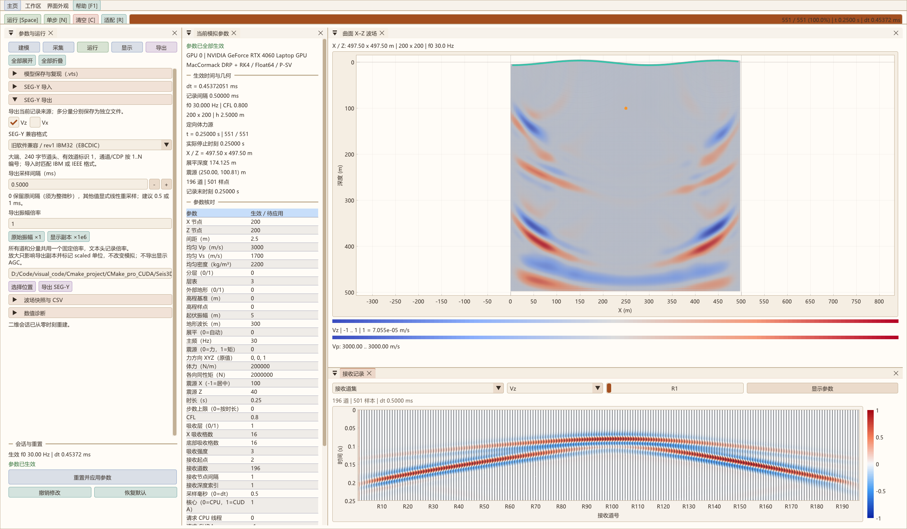

# 地震记录显示与 SEG-Y 数据交换

## 操作流程

二维参数采用待应用状态。修改主频、几何、物性、吸收或时间参数后，点击参数面板底部的“重置并应用参数”，重新建立 t=0 会话并计算 dt；“运行”及“单步”也会先应用待修改参数。正在运行时编辑参数会暂停推进，避免新旧参数混算。无效参数不会丢弃原会话。“撤销修改”恢复当前生效参数，“恢复默认”恢复默认输入，之后仍需应用。C 只清空当前生效模型的场、计时和模拟记录，保留待应用修改及导入记录。

建模、采集、运行、显示、导出保持横向入口，各页内按功能折叠；重置按钮固定在面板底部。界面外观菜单可调 16..28 px 字体，正常退出保存字号、语言和主题。F1 提供横向帮助，Esc 关闭。主页的几何、网格及底部流动波形均由程序逐帧绘制，跟随主题配色；“字号”弹出菜单可关闭动态效果。底部动画只表示传播意象，不是正演结果。

## 共用显示模块

二维和三维调用同一个 `src/common/ui/RecordView`，三维原接口通过薄包装保留。二维提供 Vx、Vz、速度幅值和单道双分量；三维保持 Vx、Vy、Vz、速度幅值和单道三分量。导入文件默认作为单分量道集。

“显示参数”支持六类样式：波形、变面积、密度、密度加波形、正负波瓣、密度加正负波瓣；可调整独立记录色带、显示增益、色标范围、透明度、逐道归一化、显示道窗，以及 AGC 的窗口、强度、噪声门限和最大提升。图内色标随增益和范围更新，小窗口减少刻度数量以避免重叠。显示操作处理副本，不改变模拟或导入原始样本。归一化及 AGC 图不能直接用于绝对振幅比较。

## 导入

进入二维“导出 → SEG-Y 导入”，选择 `.sgy` / `.segy` 文件并载入。记录区可切换当前模拟与导入文件；载入不修改计算网格、震源、模型 dt 或原接收记录。失败保留原导入数据集。导入的 dt 和每道起始延迟用于其自己的显示时间轴。

支持常用标准 240 字节道头、SEG-Y rev 0/1 及 rev 2 的受支持子集：IBM Float32、IEEE Float32/64、Int32/16/8（格式码 1、5、6、2、3、8），大端及普通小端，明确数量的扩展文本头，统一采样间隔下的不等道长、延迟和坐标标量。解码应用道加权因子；可识别道头的物理单位，未提供单位时显示 raw。英尺长度换算为米。

当前不支持额外道头块、字节对交换、未知数量的扩展文本/尾部、角度坐标或不同道采样间隔；此类输入明确报错，应先转换。导入预算为最多 4096 道、解码后 256 MiB，每道最多 1,000,000 样本。导入是记录查看，不将 SEG-Y 自动解释为速度模型，也不将真实记录当作求解初始场。

## 导出

在“SEG-Y 导出”选择记录来源和分量。模拟可勾选 Vz、Vx；多选生成 `_Vz.sgy`、`_Vx.sgy` 独立文件。导入文件可按其单一分量重新导出。默认保留原来的 rev 2 IEEE Float32 和振幅倍率 1；导出采样和固定倍率与显示增益、AGC、逐道归一化相互独立。

| 档位 | 版本 / 样点 | 文本头 | 时间轴 |
| --- | --- | --- | --- |
| 精确时间步 / rev2 IEEE32 | rev 2，格式码 5 | ASCII | 用扩展二进制字段保存非整微秒 dt |
| 精确时间步 / rev2 IEEE64 | rev 2，格式码 6 | ASCII | 同上，保留 Double 样点精度 |
| 旧软件兼容 / rev1 IBM32 | rev 1，格式码 1 | EBCDIC CP037 | 仅使用整微秒传统间隔字段 |
| 兼容 / rev1 IEEE32 | rev 1，格式码 5 | ASCII | 同上 |

各档位均使用大端及标准 240 字节道头。精确时间步档位不为凑整微秒重新采样；旧软件若只读传统间隔，会得到近似 dt。兼容档位明确填写“导出采样间隔（ms）”，默认 0.5 ms，也可填写 1 ms 等整微秒间隔；0 表示保留原间隔，但原间隔必须能用整微秒表示。指定间隔不同于来源时，对相邻接收样点做线性插值，不额外追加偏离均匀轴的末点，不修改模拟或原始记录。该处理不是低通抗混叠滤波；明显降低输出采样率前仍需验证目标频带。

兼容模式的道类型为 1（有效地震道），避免依赖旧软件对多分量类型 12/14 的识别；真实分量仍写在文本头与文件名中。所有档位补齐通道号、道序号、单炮 FFID、顺序 CDP、炮检距及中点坐标。CDP=1..N 是接收排列的顺序标识，不表示做过 CMP 网格分箱或叠加。源/接收坐标仍使用米和毫米标量。兼容档位不写 rev 2 扩展字段。具体 VISTA 版本的可读性还受其输入字典、样点类型、字节序、道过滤与显示时间窗影响，不能仅根据文件生成成功作出兼容保证。

“导出振幅倍率”默认 1，支持“显示副本 ×1e6”等固定倍乘；同次多分量导出使用相同倍率，所有道共用该常数，不做逐道归一化或 AGC。文本头记录倍率、输出峰值、因数值格式范围而变零的样点数、原始/输出间隔及是否重采样。倍率非 1 时将单位标为 `scaled(原单位)`，道头不再冒用未放大的速度单位；本程序回读时保留放大后的样值和 scaled 单位，不自动除回。需要恢复原始物理振幅时，应显式除以该倍率。较小的非零样点可由浮点格式表示，不应仅因看不到道就增大震源；先核对文件内容和显示增益。IBM32/IEEE32 均有量化及极小值下溢，IEEE64 适合要求 Double 精度的后续分析。

当前输出每道 1..65535 样本，等道长，dt 不超过 65535 μs；重新导出导入记录时，道延迟须可用整毫秒表达。每个文件先写临时文件，完整写入后替换目标文件。多分量是多个文件，不是一个交错的多分量文件。VTS 模型快照及兼容 CSV 仍在折叠项中提供。

字段定义依据 [SEG 官方 SEG-Y rev 1 规范](https://seg.org/wp-content/uploads/2025/11/seg_y_rev1.pdf)及 [rev 2.0 规范](https://seg.org/wp-content/uploads/2025/11/seg_y_rev2_0_mar2017.pdf)。验证包含分量、Float32/64、非整数微秒 dt、负坐标、毫米标量、道延迟和失败保留；增加 rev 1 IBM/IEEE、EBCDIC/ASCII、已知 IBM 位模式、有效道标识、通道/CDP、缩放单位和显式重采样检查。独立 Python `struct` 另核查标准字段及 IBM、整数、小端、扩展文本和截断文件。运行 `python -B tools/verify_segy.py`，生成文件均在外层 out。

