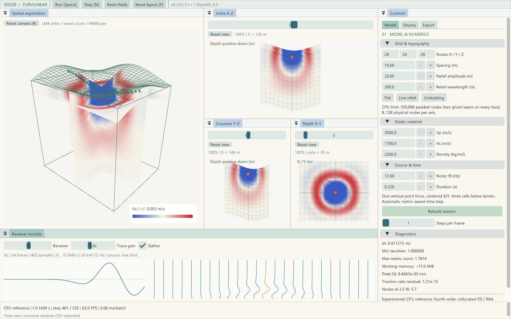

# Seis3D Curvilinear 0.16 用户指南

完整图文流程、理论、高频对照及博客打包见 [项目说明](PROJECT_MANUAL.md)。原生截图入口为 `--capture-workflow`，生成文件均在外层 out，不保存截图会话的界面偏好。

## 工作区、语言和主题

控制面板顶部固定横向显示“建模、采集、运行、显示、导出”五个入口，无需打开下拉菜单。横向入口始终位于参数滚动区之外，次级页签和折叠组保留。窄窗口和大字号下只适配导航文字尺寸，不折叠主要功能。

工作区采用 SeisSim V2 的左侧参数、中心视图、底部记录结构。左侧有“参数与运行”和“数值诊断”两个停靠页签；前者内部按建模、震源与采集、运行与性能、显示、导出分类。顶部固定命令栏提供运行/暂停、单步、清空波场 C、适配视图 R、快捷键 F1 和进度；存在待应用修改时增加“应用并重建”。窄窗口时命令自动换行。底部固定显示当前核心、dt、步数与消息。

顶栏右侧可直接切换 **English / 简体中文** 和主题。主题包括纸砂、极地、浅玉、CUDA 深绿、深海蓝、石墨灰、科研浅色、午夜紫、青蓝工作室、暖象牙白。切换即时生效并保留物理状态、相机、增益和停靠窗口 ID；关闭程序时保存偏好。Windows 默认加载微软雅黑字体，支持中文。

“工作区”菜单或显示设置可选四视图均衡、三维优先、紧凑页签、记录优先。窗口宽度小于 1500 px 时自动合并中心视图为页签；接收区为较大字号预留高度。字号可在界面外观菜单中调为 18..26 px。跨宽度档或字号变化会重新排布，手动停靠在同一宽度档、同一字号下保留；语言和主题本身不重置布局。

各停靠面板页签/标题栏有 **×** 关闭按钮。通过 **工作区 / Workspace** 菜单勾选可重新打开任一面板；**F / 恢复布局** 同时重新打开全部七个面板并恢复布局。面板关闭状态随界面偏好保存，关掉视图或参数区不会暂停求解器；顶栏仍可运行/暂停。

颜色按功能区分：绿色运行、蓝色模型与重建、青色显示、紫色导出、琥珀色网格/警告、红色清零/重置。所有主题保留这一功能对应关系，深浅色下分别调整明度。

接收几何、计时公式、CPU/CUDA 比较流程和 CSV 字段见 [接收排列与性能对比](ACQUISITION_AND_PERFORMANCE.md)。推进耗时在求解器中逐个完整时间步统计，与绘图帧率分开；初始化耗时单列。

## 初始最大步数与主频检查

**默认模拟时长为 1 s，最大计算步为 5000**。它与模拟时长先到者停止，并不强制计算满 5000 步。设为 0 可按完整时长运行。接收记录包含零时刻，5000 个推进步骤对应 5001 个接收样本。修改上限需应用并重建。

运行页和震源设置会显示已生效主频、Ricker 主峰时刻、物理范围，以及 `2.5*f0` 处最短 S 波波长的节点数。该节点数用最大物理网格边长估计，小于 5 时警告波形采样不足；即使程序不发散也不能认为波形准确。震源设置显示参考主频上限，数值诊断给出源采样 dt 上限和每主频周期步数。高频时采用 `dt <= 1/(50*f0)`；空间采样不足仍需细化网格或降低主频。

尺寸/主频矩阵的完整回归会显式设最大步数为 0，覆盖完整震源和后期传播，避免界面默认的 5000 步截断测试。

## CPU / CUDA 与稳定性设置

程序启动默认优先选用可用的 CUDA；无 CUDA 构建或无可用设备时选择 CPU，性能页显示检测信息。仍可手动切换。显式选择 CUDA 后的初始化失败不会悄悄换用 CPU。

在 **运行与性能 → 性能对比 → 计算后端** 选择 CPU / OpenMP 或 CUDA GPU，再按 **Apply changes / rebuild**。两者使用相同的 Float64 离散公式、CFL、震源和边界。切换会从 t=0 重算；相机、切片、色带及增益保留。失败时原会话保留。CUDA 未编译、无兼容设备或驱动不可用时，选项禁用并显示原因。CPU workers 只影响 CPU。

多显卡计算机可先点击“重新检测显卡设备”，查看每块 CUDA 卡的型号、计算能力、PCI 地址及剩余/总显存，再从 CUDA 设备下拉框选择。自动模式选择总显存最大的可用卡；刷新列表本身不改变当前模拟，选卡需应用重建。一次模拟使用一块计算卡，显示卡可以不同。构建入口是 Git 仓库根目录，所有构建、偏好和模拟输出均在仓库外的 `../out`；发表图片与图标原件则随仓库保存在 docs/resources 中。

CUDA 构建方式见 README。运行时 GPU 保存九个场和 RK 缓冲；显示仅回传三切片、统计和接收记录，全体积回传只发生在显式 VTS 导出。

**运行 → DRP CFL 系数** 范围 0.02..0.8，默认 **0.8**。旧上限 0.22 是早期中心差分版本的保守设置，0.13 对交替 DRP 核心重新验证后放宽；仍可填 0.22 复现旧时间网格。系数进入 `dt_wave=C*min(h/M,Lmin)/Vp_max`，不是对统一理论极限的百分比。除逆度量和相邻八平面距离约束外，程序还要求 `max(damping)*dt <= 0.5` 和 `dt<=1/(50*f0)`。运行页显示当前由波传播/几何、吸收阻尼还是震源采样限制 dt；达到后两者上限时，继续增大 CFL 不会提速。Diagnostics 还显示实际 `Vp_max*dt/h`、各项上限、几何距离与弹性能量。验证范围和规则网格对照见 [0.13 CFL 检查](VERIFICATION_0_13.md)。

每个完整步都会检查有限性。在震源窗口 `t <= 3/f0` 后，若机械能增长到震源窗口峰值的 10,000 倍以上，也会停算并保留上一有效步及接收记录。该阈值是发散报警，不是能量守恒证明；停算后需重建恢复。当前使用交替 MacCormack-DRP、四阶段 RK 权重、Traction Image 及近表面降阶；CFS-PML 尚未移植。原函数和解析波验证的范围见 0.11 实测记录。

## 吸收边界设置

在 **建模 → 边界 → 吸收边界** 中设置：

- **启用数值吸收**：开启侧面及底部海绵；关闭后会出现外边界反射。
- **厚度 X/Y/底部 Z（单元）**：默认 8/6/8，可输入 1..64；实际每方向最多占本方向节点数的三分之一，面板显示生效值。
- **吸收强度**：默认 3，可设 0.1..10；过强并不保证更低反射。
- **显示吸收区域**：即时开关二维、三维切片的琥珀色叠加；在“显示”页也可切换，透明度可调。它不改变数值吸收。

前三项修改后点“应用修改并重建”。顶面保持自由表面。层宽按各轴分别计算，窄 Y 不再连带缩短 X/Z 海绵。吸收设置参与 CPU/CUDA 性能工况匹配。

## 30–60 Hz 的起始参数

主频没有 30 Hz 输入上限；界面的主频参考值是空间采样建议。给定 Vp/Vs=3000/1700、h=10 m，60 Hz 的 P/S 波每主频波长分别只有 5/2.83 个节点，2.5f0 处 S 波只有 1.13 个节点。当前五点交替 DRP 与规则项目八阶交错差分的短波误差不同；规则项目默认爆炸源，当前体力源直接产生 S 波，不能只比较平滑的 P 波波环。详细内点对照见 [0.16 审查](VERIFICATION_0_16.md)。

先按 `h_max <= Vs_min/(8*2.5*f0)` 估计空间采样，再由程序计算时间步。均匀模型 Vp=3000、Vs=1700 m/s：30 Hz 可从 h=2.5 m 开始，50 Hz 从 h=1.5 m 开始；黄土五层最小 Vs=250 m/s，则分别建议 h≤0.4 m、h≤0.25 m。曲面拉伸可能要求更小计算间距。8 个节点/最短有效波长是初始采样建议，不是反射和相位误差的保证。

均匀模型先设为平地（地形振幅 0），可用 200×20×200、50 Hz、h=1.5 m、CFL=0.8、时长 0.12 s 检查波形，并与较小 CFL 对照。默认 5000 步通常可覆盖此时段，具体看运行页显示的结束时间。20 个 Y 节点只宽 28.5 m；应扩大 Y 并做边界距离对照后再解释三维振幅。保留起伏时需重新检查实际采样指标，本次 2 m 起伏的 50 Hz 验证采用 h=1.25 m。

缩小 h 会缩小固定节点数下的物理范围。黄土五层总有限厚度 50 m，在 h=0.25 m 时至少需要 201 个 Z 节点才刚好覆盖，需额外留出基岩和底部吸收区。地形振幅/展平深度也须适应新深度。

均匀介质 60 Hz 可从 h=1 m、地形振幅 2 m、波长 100 m 开始检查。实际 48×20×64、源深度索引 20、0.12 s 算例已完成 900 步，dt=0.133333 ms，PPW=9.312；这是有限性和源窗检查，不能代替远场/边界精度验证。震源页另显示待应用主频对应的 8 PPW 最大物理边长及名义 f0/2.5f0 采样，不再把采样建议称作输入上限。

## 运行控制更新

Controls 新增默认打开的 **Run** 页签，集中显示进度、步数、当前/终止模拟时间、计算速率和预计剩余秒数。**Maximum steps** 范围为 0..20,000：0 按 Duration 自动计算；正数表示最多推进该步数，时长先到则按时长结束。修改后点击 **Apply changes / rebuild**，场与接收记录从零开始。

最大步数不会增大时间步长。求解器先按 CFL 和完整时长确定 dt，再截断步数；因此较小上限对应较短的实际模拟时间，可能尚未到达 Ricker 主脉冲。Run 页签显示实际终止时间。

**Steps / frame** 为每帧最多完整步数，**Budget (ms)** 默认 16 ms，在步间检查并让出界面。完整单步不能中断，因此该预算不保证固定帧率。预计剩余时间由近期完整步平均耗时估算，不含暂停和导出时间。

## 1. 启动

在项目根目录执行：

```powershell
cmake --preset x64-Release
cmake --build --preset x64-Release
.\out\bin\Release\Seis3DCurvilinear.exe
```

首次启动会初始化小型算例，优先使用可用 CUDA，默认暂停。窗口在完成首帧绘制后才显示，以避免启动白框。图形资源从 EXE 同级 `shaders` 文件夹加载，不依赖启动工作目录。



默认模型：28 × 24 × 28 个物理节点、间距 10 m、Vp 3000 m/s、Vs 1700 m/s、密度 2200 kg/m³、Ricker 主频 12 Hz、模拟时长 1 s。地表振幅 20 m、波长 300 m。网格四周各有三层计算虚点，导出时排除虚点。

## 2. 工作区

- **Spatial exploration**：三维物理空间中的曲面地表线框和三张波场切片。橙色点表示震源，青色点表示接收器。按视口实际像素分辨率创建渲染目标，使用最多 4 倍多重采样。
- **Inline X-Z / Crossline Y-Z / Depth X-Y**：物理坐标剖面。X-Z 和 Y-Z 显示地表引起的网格弯曲；X-Y 对应固定计算深度层，随地表起伏，并不等同于全域固定物理高程平面。
- **Receiver records**：一条接收线的道集和选中单道三分量。默认接收线位于 Y 中间、一格地表以下；沿 X 内部节点部署 nx−4 道，另支持自定义 X/Y 测线及最多 1024 个接收点的 X-Y 面阵，包含 t=0 的初始零样本。
- **Controls**：按功能分类显示 Model/Materials、Source/Receivers、Run/Performance、Display、Export 页签与诊断信息。分组可以折叠。各窗口可以拖动停靠，布局存到 `../out/ui/workspace.ini`。

## 3. 模型、震源与运行

接收几何页显示按起点、间隔和节点数计算的每方向容量，以及固定另一方向道数时的面阵耦合上限。容量为 `1+floor((N−1−start)/stride)`，道数表示位置数；−1 表示起点在轴中心。1024 是总接收位置数上限，不是每方向上限；每位置另有三分量。自动 X 线两端各留两点，Nx=300 时为 296 道；自定义起点 0、间隔 1 则可放 300 道。单线不使用的方向间距显示为 0。“适配接收道数”只在点击时修正道数，仍需应用部署。

在 Model 中编辑网格、间距、起伏；Materials 设置均匀／分层物性；Source 设置位置与主频；Run 设置时长、最大步数及 CFL；Performance 选择计算核心和 CPU 线程数（0 自动，最多 64）。参数编辑后会显示 pending 提示，只有按 **Apply changes / rebuild** 才会重建物理状态。非法参数不会丢弃上一个可用模型。

物理网格每边可设为 8..300，最大 300×300×300；三层虚点使最大存储尺寸为 306³（28,652,616 节点）。模型页显示待应用节点数、主机/显存估算及当前可用容量。预检按主机可用容量的 80%、CUDA 可用显存的 90% 留余量，容量不足时在分配前拒绝并保留当前会话。系统同时限制实际推进步数为 20,000。

“按可用内存适配网格”仅在点击后按比例缩小各轴节点数；保留间距，并适配越界的源、接收位置。实际物理尺寸随节点数改变，结果仍需应用重建。直接编辑节点数不会自动缩小。均匀 Float64 CUDA 300³ 模型预计约需 16.67 GiB 显存，8 GiB 显卡不能运行该尺寸；以 8 GiB 可用显存、64 GiB 可用主机内存估算，适配结果为 225³，实际建议依据当时可用容量更新。200³ CUDA 已做两步及清空检查，该短测不代表完整时长精度验证。

要求 `Vp² > 4 Vs² / 3`，以保证正体积模量。输入必须有限；主频和模拟时长必须为正。主频改变会影响波长采样数和震源时延；当前 Ricker 延迟为 `1.5 / f0`，时长短于该值时可能看不到主要脉冲。

安全时间步长使用全网格逆度量张量范数的最大值，地表变陡时会自动缩短步长。设定的时长按整数步精确覆盖。诊断区显示 dt、Jacobian、度量范数、工作内存估算和以 `2.5 f0` 估算的最短波长采样数；少于 5 个节点时给出欠采样提示。

底部 dt 始终属于当前生效会话。修改参数后，模型/运行页另列“待应用 dt、步数和停止时刻”；平地使用精确单位度量，曲面几何未变时可复用当前几何指标进行预览。曲面的节点数、间距、振幅、波长或展平深度改变后，提示应用重建计算新度量，不使用旧几何给出新 dt。应用成功后更新全部实际参数、dt 和记录采样间隔；失败保留原会话。仅改变步数上限不改变 dt。

当前仅一个竖直体力震源：默认 X/Y 中心、Z 索引 3。在 **Source / 震源** 页设置从零开始的网格索引；X/Y=-1 自动居中，否则三个索引均须在 2..N−3 内，以容纳完整震源核。实际物理坐标由曲网格映射得到，Z 正向向下，“地表以下”深度按当地地表计算。位置和主频修改均需应用重建，并清零记录；“切至震源位置”仅移动切片至当前生效震源。用标准差为一格、半径两格的归一化高斯核投影到网格，保持总力归一化，降低单节点点源激发的网格尺度棋盘模式；它是有限支撑的点源近似。介质支持均匀或分层各向同性；尚未加入多个炮点或任意 VTS 导入。

Run / Pause 持续推进，Step 只推进一步。Steps per frame 控制每帧完整 RK4 步数。清空波场 C 原位清零九场、RK 工作区、接收记录和推进计时，回到 t=0 并暂停；保留几何分配、当前 dt、初始化耗时、显示设置及待应用参数。清空不应用参数修改；“应用并重建”才创建新模型。该行为在 CPU/CUDA 上一致，避免大模型只清空时重新分配几何。

模型预设按 X×Y×Z 排列：200×20×200、100×20×100、50×20×50、200×50×100、100×100×100、200×200×200、300×300×300。后三项也有快捷按钮。首项载入完整波场验证工况（12 Hz、源 100/10/50、0.5 s、CFL=0.8、均匀物性、海绵 6/6/6）；其余项暂存几何并保留有效源及停止设置，源越界时按相对位置适配，自定义接收道数适配新边界。都需应用重建。

建模页同时显示当前真实尺寸和待应用网格跨度。后者为 `(N−1)h`，前者从重建后所有物理节点坐标取最小/最大值，不含虚点、包含海绵区；两者不能混用。起伏地表可能使真实 Z 包围盒高度大于计算深度，包围盒高度也不等于每一竖直列的厚度。尺寸和坐标使用普通十进制并去除多余末尾零，例如 `1990 × 2000 m`。三维显示尺寸、二维米制坐标可在显示页分别关闭。

分层介质的表格、坐标选择、1 m 薄层算例及图标说明见 [层状模型与图标](LAYERED_MODELS.md)。默认“按网格层对齐”保证同一 k 水平节点层的物性相同；两种物理深度模式会优先保持指定埋深，可能呈节点台阶。介质预设仅暂存材料，不自动改几何；应用重建后才生效。

## 4. 显示和相机

三维视口：左键拖动旋转，滚轮或右键拖动缩放，中键拖动平移，Reset camera 恢复相机。

切片：滚轮以鼠标处为中心缩放，中键拖动平移，左键选择最近格点并联动其他切片。Reset view 仅重置当前剖面的视图；Display 中可重置所有切片视图。

显示页先选“仅波场 / 仅模型 / 模型与波场叠加”。“波场外观”选择 Vz、Vx、Vy、速度模、压力（负平均应力），单独设置色带、增益、幅值范围和归一化；“模型配色”选择 Vp、Vs、密度，独立设置色带及物理范围。模型自动范围采用配置物性的最小/最大值，均匀材料用 0..该值；也可为每种物性手动指定范围。两类范围互不覆盖。

两类颜色都提供 14 组五节点色带。Q 循环波场色带，E 循环模型色带，Shift 反向。叠加时可调波场透明度及弱波阈值，零波场透出模型底图。叠加颜色会随底图变化，但波场本身的映射和色标不变。主题仍有十种浅色及深色样式。

切片顶部显示当前平面的节点数（X-Z：Nx×Nz，Y-Z：Ny×Nz，X-Y：Nx×Ny），旁边“网格”开关作用于全部切片和三维切片网格。每个节点行/列都绘制，不再抽样成约 12 条线；例如 100×20×100 模型的 X-Z 切片为 100×100 个节点、99×99 个单元。显示页“网格透明度”调节线条强度，“切片十字线”“地表线框”分别控制联动选点线和顶面线框。网格密集时可以放大或关闭。

二维和三维切片使用同一套颜色映射。默认勾选 **显示 → 波场外观 → 波场色标归一化**：Vz/Vx/Vy/应力刻度 −1..1，速度模 0..1。色标下方的 `1 = … m/s` 或 `1 = … Pa` 给出对应的物理饱和值。模型色标独立使用 m/s、kg/m³。叠加模式显示两条色标，可分别关闭；较窄窗口会分行显示。

归一化值定义为 `物理值×显示增益/参考范围`，饱和时裁剪到色带端点。该开关只切换刻度单位，二维/三维颜色和原始 SI 场保持一致；不影响导出和数值时间步。Auto range 独立控制参考范围是否跟随当前峰值，显示增益也独立保留。自动范围下 Vx/Vy/Vz/速度模共用当前最大速度模，应力单独缩放。可通过“显示色标”关闭全部色标。归一化选择随界面偏好保存，重置显示参数恢复默认勾选。

W 只循环五种波场分量；模型物性分量在“模型配色”单独选择。记录区仍使用自己的色带设置。文本输入或控件正在编辑时不响应快捷键；Ctrl/Alt/Super 组合不触发 Q/W/E。显示模式、分量、两类色带/色标开关、模型手动范围和尺寸/坐标开关保存在界面偏好中。

默认使用固定幅值参考和归一化色标刻度。颜色饱和值由 `固定范围 / Wave gain` 决定；切换分量、色带、主题、模型重建和清零场都不会隐式重置增益或固定范围。速度与应力使用各自的 SI 量纲参考范围。Auto range 取当前物理区域的幅值，计算虚点不参与。

只有 **Reset visual parameters** 会统一恢复显示参数默认值。更改主频、材料或网格后，物理振幅本身也会改变；固定色标下的颜色变化不一定代表增益设置被重置。

接收记录可选择道集或单道三分量，分量包括 Vz、Vx、Vy、速度模。显示参数中提供波形、变面积、密度、密度叠波形、正负波瓣、密度叠正负波瓣六种样式，以及 14 种色带、增益、色标范围、透明度、全局/逐道归一化、AGC 窗长、放大上限与噪声门限。可限定起始道和可见道数，点击道集选择道，使用图表缩放和平移；重新适配可恢复全范围。为控制绘图开销，波形预览保留极值与端点、最多 2048 点，密度最多 1024 时间行。AGC 与归一化仅用于显示，悬停读数和 CSV 仍为原始 SI 数据。

## 5. 数据输出

Export 中可编辑完整文件名，也可通过 Browse 选择文件夹与名称。

- **VTS**：VTK XML StructuredGrid，包含所有物理点显式坐标、Vp、Vs、密度、Vz、速度模、压力、六个应力分量和三分量 Velocity 向量，均匀介质共 13 个点数据数组，分层时另有 LayerId；Vp、Vs、Density 为逐节点物性。压力定义为 `−trace(sigma)/3`（Pa），为保持旧文件接口，数组仍使用历史名称 `MeanNormalStress`。元数据保存快照时间、dt、步号和实际震源坐标。输出为原始 SI 数值，不含显示增益。
- **CSV**：第一列 time_s，后续为各接收器 Vz，文件头记录位置和单位。勾选三分量输出时，各道按 Vx、Vy、Vz 排列；默认仍输出 Vz。样本数为已推进步数加 1，时间从 0 开始，采样间隔等于当前 dt。重建模型会重新生成接收记录。

默认导出路径位于项目 `out`。VTS 采用 ASCII XML，适合当前小案例检查，后续大模型可升级 appended binary。

## 6. 快捷键

| 快捷键 | 功能 |
|---|---|
| Space | 运行 / 暂停 |
| N | 单步 |
| C | 原位清空波场、记录和推进计时，回到 t=0 并暂停 |
| Q / Shift+Q | 下一种 / 上一种波场色带 |
| W / Shift+W | 下一个 / 上一个波场分量 |
| E / Shift+E | 下一种 / 上一种模型配色 |
| R | 适配三维相机及全部二维切片视图 |
| G | 显示 / 隐藏切片网格 |
| B | 显示 / 隐藏吸收区域叠加 |
| V | 显示 / 隐藏三维视口中的三张切片 |
| F1 / Esc | 打开 / 关闭快捷键说明（Esc 仅关闭说明） |
| F | 恢复默认停靠布局 |
| Ctrl+S | 导出当前 VTS 快照 |
| Tab | 控件间移动焦点 |

以上键位参考规则网格三维项目。当前工作台的 V 对应三维切片；Tab 保留控件导航。文本输入、控件处于编辑状态或菜单打开时，工作区快捷键暂停响应。

## 7. 验证与适用范围

详细公式、源的物理归一化、表面局部求逆、虚节点、RK4、CFL/采样、离散能量和显示量纲见 [数值原理与实现](NUMERICAL_METHOD.md)。窗口与网格专项检查可运行 `--smoke-workspace`，输出到 `../out/workspace-review`。

```powershell
ctest --preset x64-Release
.\out\bin\Release\seis3d_curvilinear_demo.exe
.\out\bin\Release\Seis3DCurvilinear.exe --smoke
python tools/verify_exports.py
```

验证程序检查平面网格度量、曲率对 CFL 的影响、分帧/整批推进一致性、有限非零弹性响应、未经最终应力投影的表面牵引变化率、接收时间轴和非法参数防御。

另用解析光滑场在同一曲面网格上加密一倍，检查物理梯度误差是否按接近四阶的速度下降；该检查覆盖空间链式变换，不等价于完整自由表面波动解的收敛验证。

`--smoke` 在隐藏窗口中推进模型并渲染实际 OpenGL/ImGui 画面，生成 `../out/gui_smoke.ppm` 后退出，用于启动和渲染检查。它不会修改普通工作区布局。

这是 CPU/CUDA 双后端工作台。长时能量衰减、时间步收敛和后端一致性已有回归检查；自由表面反射精度与海绵反射率仍需标准算例定量对照。不能仅凭画面和投影后零残差认定与 CGFD3D 等价。详见 [数值验证说明](NUMERICS_AND_VALIDATION.md)。
